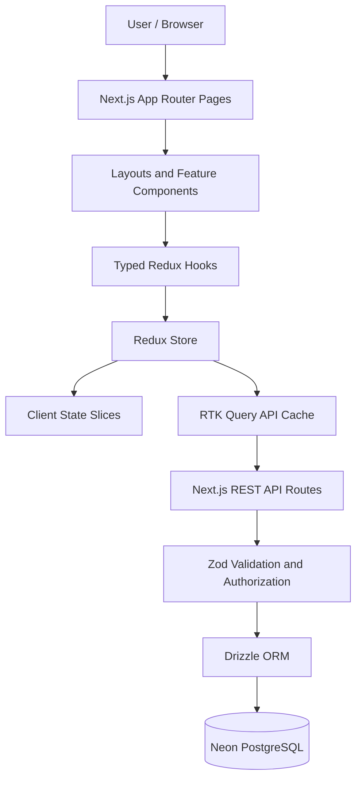

# 01 — Frontend Architecture

## 1. Purpose

DataScope uses Next.js App Router and TypeScript to separate route composition, reusable UI, feature behavior, API communication, and shared client state.

## 2. High-level architecture



## 3. Main application modules

| Module | Responsibility |
|---|---|
| Public pages | Landing page, login, registration |
| Overview | Dataset-level summary and dashboard metrics |
| Data Explorer | Searchable, filterable, sortable record exploration |
| Dataset Library | Dataset metadata and discovery |
| Advanced Search | Field/operator/value-based search conditions |
| Analytics | Aggregated charts and business metrics |
| Saved Views | Persist and restore search configurations |
| Record Details | Inspect one record |
| User Management | Administrator user and role management |
| Profile | User-facing account information |

## 4. State boundaries

| State type | Recommended owner | Examples |
|---|---|---|
| Global client state | Redux slices | Authenticated user, active dataset, explorer preferences |
| Server state | RTK Query | Record pages and API responses |
| URL state | Next.js route/search parameters | Shareable dataset/search context (verify completeness) |
| Temporary component state | React component state | Open dialog, current input draft, menu state |

Large record collections should not be copied into ordinary Redux slices. RTK Query should own fetched server data and its cache.

## 5. Redux store

Known store reducers:
- `auth`
- `datasets`
- `explorer`
- `savedViews`
- `uiPreferences`
- RTK Query reducer (`recordsApi.reducerPath`)

The store middleware includes `recordsApi.middleware`. Typed `RootState` and `AppDispatch` are exported, with typed hooks in `src/store/hooks.ts`.

## 6. Known source layout

```text
src/
├── app/
│   ├── api/
│   ├── login/
│   ├── register/
│   ├── overview/
│   ├── explorer/
│   ├── datasets/
│   ├── advanced-search/
│   ├── analytics/
│   ├── saved-views/
│   ├── records/
│   ├── admin/
│   └── profile/
├── components/
│   ├── auth/
│   ├── layout/
│   └── providers.tsx
├── db/
│   ├── schema/
│   └── seed/
├── lib/
└── store/
    ├── api/
    ├── slices/
    ├── hooks.ts
    └── store.ts
```

Verify this tree against the final repository before submission.

## 7. Maintainability principles

1. Keep route files focused on page composition.
2. Keep reusable controls in shared components.
3. Keep feature-specific behavior close to its feature.
4. Validate API inputs at the server boundary.
5. Keep authorization on the server; UI visibility is not security.
6. Avoid storing the complete dataset in client state.
7. Keep shared state serializable and narrowly scoped.

## 8. Gaps to verify

- Dynamic schema-driven columns and filters for arbitrary datasets.
- URL synchronization for every search/filter/sort field.
- Error boundaries and loading skeleton coverage.
- Table virtualization, multi-column sorting, resizing, selection, and highlighting.
- Accessibility and keyboard navigation.
