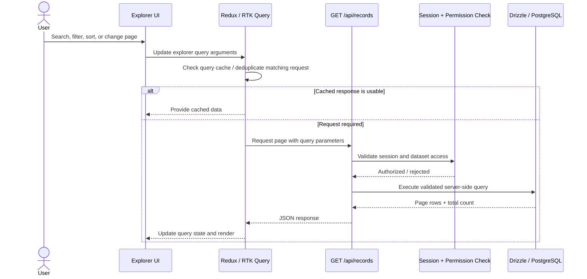

# 02 — Data Fetching Flow

## 1. Selected approach

DataScope uses RTK Query for record retrieval and caching, with Redux Toolkit slices for shared client-side configuration. PostgreSQL performs filtering, sorting, and pagination on the server.

## 2. Request lifecycle

## 3. Query inputs

Known record query parameters include:
- `datasetId`
- `page`
- `pageSize`
- `search`
- `filters`
- sorting field and direction

The API validates the dataset identifier, pagination bounds, filter fields/operators, and sorting fields. The exact serialized parameter names should be confirmed in `src/store/api/recordsApi.ts` and `src/app/api/records/route.ts`.

## 4. Server-side versus client-side work

| Work | Location | Reason |
|---|---|---|
| Authentication and authorization | Server | Cannot trust client role or dataset selection |
| Search and filtering | PostgreSQL/API | Avoid transferring all records |
| Sorting | PostgreSQL/API | Consistent ordering before pagination |
| Pagination | PostgreSQL/API | Return only the requested page |
| Table presentation | Browser | Interactive rendering |
| Current page/query configuration | Redux / URL as appropriate | Shared UI behavior and navigation |
| Record response cache | RTK Query | Reuse server responses |

## 5. Caching and invalidation

RTK Query caches requests by endpoint and argument combination. Identical active query arguments can share cached results and avoid duplicate network work.

**Verify before submission:**
- Whether `keepUnusedDataFor`, `refetchOnFocus`, or `refetchOnReconnect` are configured.
- Whether mutations invalidate relevant tags.
- Whether polling/background refresh is configured.
- Whether search inputs are debounced before query arguments change.

Do not claim these behaviors unless they are present in the current code.

## 6. Error and loading behavior

The UI should distinguish:
- Initial loading.
- Background fetching with existing data.
- Empty result.
- Validation error.
- Unauthorized / forbidden response.
- Server/database failure.
- Network failure.

A failed request should not silently replace a valid result with misleading empty data. Display a retry path where appropriate.

## 7. Millions of records

The current sample contains 100,000 records. For growth toward millions:
- Keep filtering, sorting, and pagination in PostgreSQL.
- Add indexes based on measured query plans and filter frequency.
- Consider cursor pagination for deep page navigation.
- Consider asynchronous export jobs for large exports.
- Consider a dedicated search engine only if PostgreSQL search no longer meets measured requirements.

## 8. Mandatory presentation answers

Explain why RTK Query was selected over manual thunks, how query arguments define cache identity, which mutations invalidate which data, how concurrent requests behave, and what happens during slow or failed network requests.
