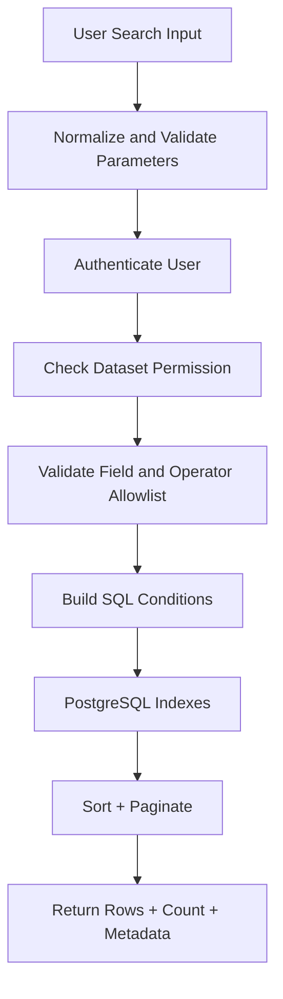

# 03 — Search Architecture

## 1. Overview

DataScope sends search and filter conditions to the backend. The backend validates allowed fields and operators, builds a database query with Drizzle ORM, and returns only the requested page.

## 2. Known filter fields

The current records endpoint has an allowlist for:
`transactionId`, `customerName`, `email`, `product`, `category`, `amount`, `quantity`, `status`, `region`, `paymentMethod`, `orderDate`.

Known operators:
- `eq`
- `neq`
- `contains`
- `gt`
- `gte`
- `lt`
- `lte`
- `between`

Supported filter behavior should be confirmed against the final API implementation. Current advanced search combines conditions using AND; OR/grouped Boolean expressions are not confirmed.

## 3. Sorting

Sorting fields are allowlisted. Known fields include:
`externalId`, `createdAt`, `amount`, `quantity`, `customerName`, `product`, `status`, `region`, `orderDate`.

The API currently supports a selected sort field and direction. Multi-column sorting must be verified and should not be described as complete unless implemented.

## 4. Indexing strategy in the current database

Known indexes include:
- B-tree index on `dataset_id`.
- B-tree index on `created_at`.
- Unique composite index on `(dataset_id, external_id)`.
- GIN trigram index on `searchable_text` using `pg_trgm`.
- GIN index on JSONB record data.
- `ANALYZE` run after data generation/index setup.

Indexes improve selected lookup patterns but add storage and write overhead. Index selection should be supported by `EXPLAIN (ANALYZE, BUFFERS)` evidence.

## 5. Search approach comparison

| Approach | Strengths | Trade-offs | Suitable when |
|---|---|---|---|
| PostgreSQL Full-Text Search | Native PostgreSQL, tokenization and ranking | Language configuration and token semantics need tuning | Natural-language token search |
| PostgreSQL Trigram (`pg_trgm`) | Useful for substring/fuzzy matching; integrates with PostgreSQL | Index size and write overhead; not a complete search platform | Partial text matching over moderate/large relational data |
| Elasticsearch / OpenSearch | Rich relevance, analyzers, distributed search features | Extra infrastructure, synchronization, operational cost | Search scale/features exceed database-native capabilities |

**Current selection:** PostgreSQL trigram search is known to be implemented for partial matching against `searchable_text`. Full-text search and external search engines are comparison alternatives, not confirmed deployed components.

## 6. Query safety

- Validate dataset IDs and pagination bounds.
- Use explicit field/operator allowlists.
- Parameterize values through the ORM.
- Enforce session and dataset authorization on the server.
- Reject malformed filter JSON and unsupported operators.
- Never trust client-side role checks as authorization.

## 7. Search improvements to verify or implement

- Debounced search input.
- Search term highlighting.
- OR conditions and nested condition groups.
- Dynamic filter definitions from dataset schema.
- Stable secondary ordering for duplicate sort values.
- Query-plan capture for slow searches.
- Search performance dashboard.
- URL-shareable search state.

## 8. Scaling limits

Trigram indexes are not a universal solution. Reassess when measured latency, index size, write throughput, language analysis, relevance ranking, or distributed-search needs exceed PostgreSQL's practical capacity. Make that decision from representative workload benchmarks, not record count alone.
