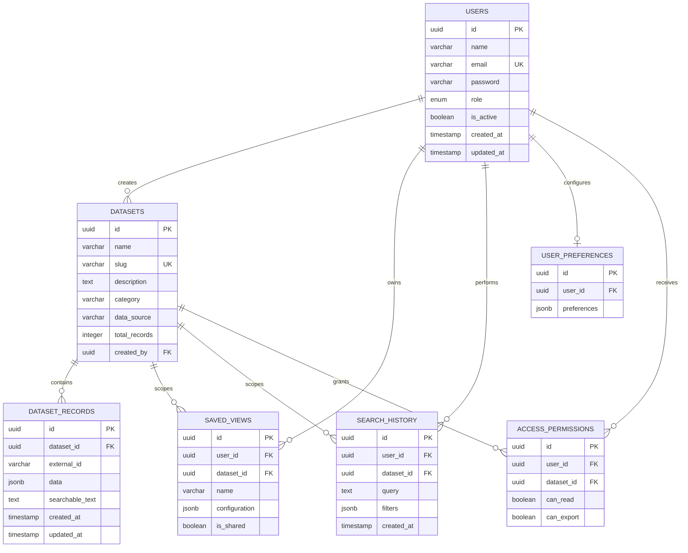

# 04 — Database Design & ER Diagram

## 1. Database technology

- PostgreSQL hosted on Neon.
- Drizzle ORM for typed schema and database access.
- JSONB stores flexible record payloads.
- `searchable_text` provides a text-search projection for record content.

## 2. Known entities

| Table | Key fields / purpose |
|---|---|
| `users` | User identity, email, password hash, role, active status, timestamps |
| `datasets` | Dataset name, slug, description, category, source, record count, creator |
| `dataset_records` | Dataset reference, external ID, JSONB data, searchable text, timestamps |
| `saved_views` | User, dataset, name, configuration JSONB, sharing flag |
| `search_history` | User, dataset, query, filters JSONB, creation time |
| `user_preferences` | Unique user reference and preferences JSONB |
| `access_permissions` | User/dataset relationship and read/export permission flags |

## 3. ER diagram

## 4. Relationship notes

- One dataset contains many records.
- A user can create multiple datasets.
- Saved views belong to a user and dataset.
- Search history belongs to a user and dataset.
- A user has at most one preferences row.
- Access permissions associate users with datasets.
- Foreign-key cascade behavior is configured for several user/dataset-owned rows; confirm every constraint in the schema before submission.

## 5. Indexes

Known index strategy:
- B-tree: dataset ID and created timestamp.
- Unique composite: dataset ID + external ID.
- GIN trigram: searchable text.
- GIN: JSONB record data.

## 6. Data generation

The seed script creates 100,000 synthetic customer transaction records in batches of 500. The known dataset slug is `customer-transactions-100k`.

Example fields include transaction ID, customer name, email, product, category, amount, quantity, status, region, payment method, and order date.

## 7. Schema limitations to disclose

The current flexible JSONB record design is convenient for semi-structured datasets, but a fully generic enterprise dataset catalog may require a `dataset_fields` metadata table, field types/validation rules, relationships, and schema versioning. These are not confirmed in the known current schema.
